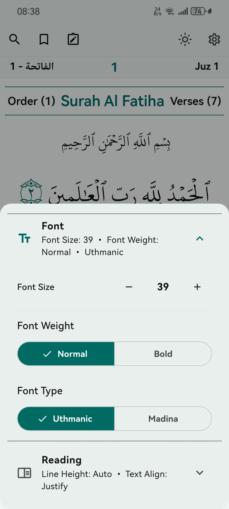
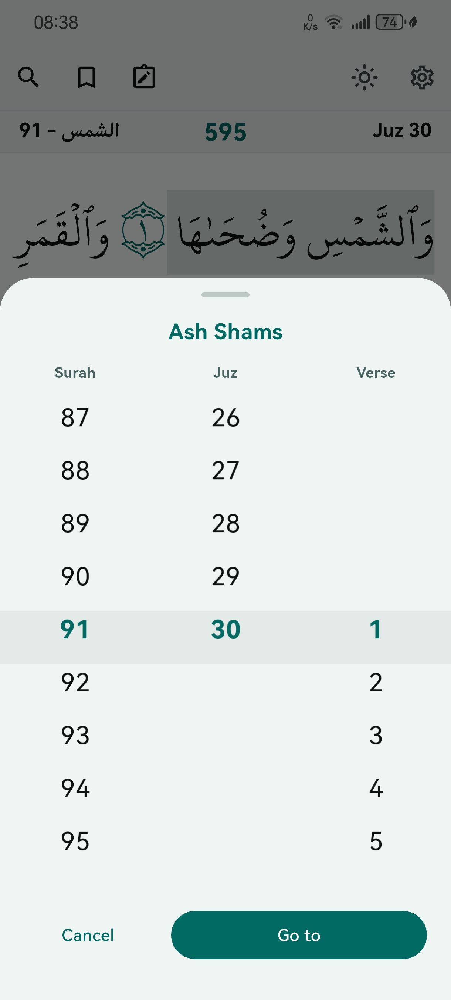
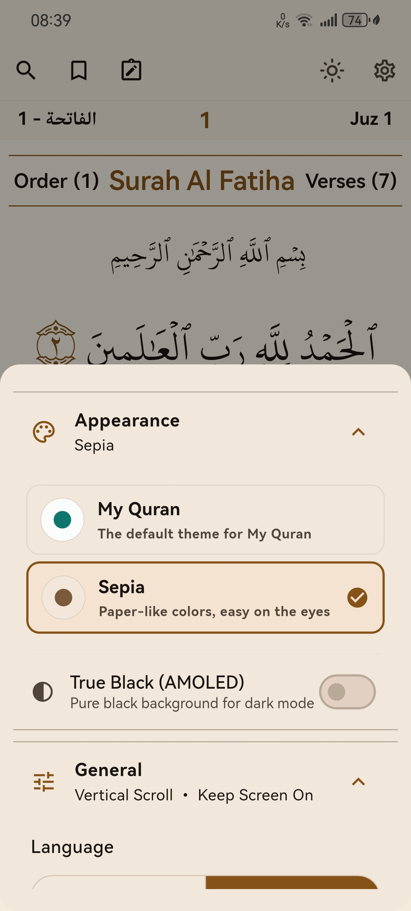

<div align="center">

  
  <br>

  # Коран HD

  Лицензия: [GNU GPL v3](LICENSE) • Репозиторий: [solemetra/my_quran_book](https://github.com/solemetra/my_quran_book)

</div>

---

## О приложении

Быстрое, удобное и полностью автономное приложение для чтения Священного Корана на планшетах и смартфонах:

- **100% Офлайн**: не требует интернета, без рекламы и без аналитики.
- **Риваяты**: Хафс и Варш (шрифты Медина и Усмани).
- **Навигация**: Сура → Джуз → Аят с быстрым переходом.
- **Статистика и Хатм**: учет времени чтения, серий дней и прогресса завершения Корана с дуа.
- **Закладки и заметки**: гибкие категории с цветными метками и локальный экспорт/импорт.
- **Адаптивный интерфейс**: Material You (M3 Expressive), фирменная изумрудная тема, сепия, AMOLED-режим и плавная прокрутка 120 FPS.

---

## Build from source

```bash
git clone https://github.com/solemetra/my_quran_book.git
cd my_quran_book
flutter pub get
flutter run
```

---

## Legal

- **Software**: [GNU General Public License v3](LICENSE) — you may use, modify, and redistribute under GPL terms.
- **Third-party fonts and Quran data**: see [NOTICE.md](NOTICE.md) (KFGQPC fonts, Scheherazade, etc.).
- **Copyright**: see [COPYRIGHT.md](COPYRIGHT.md).

---

<div align="center">

  
  
  

</div>
