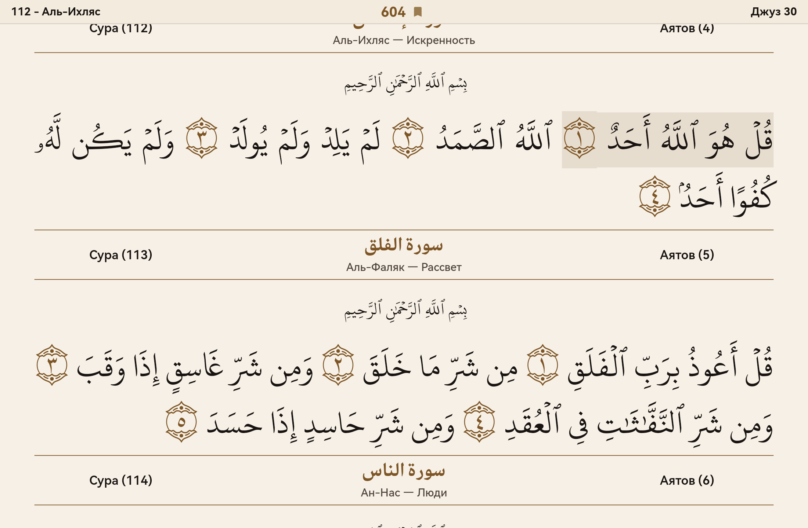
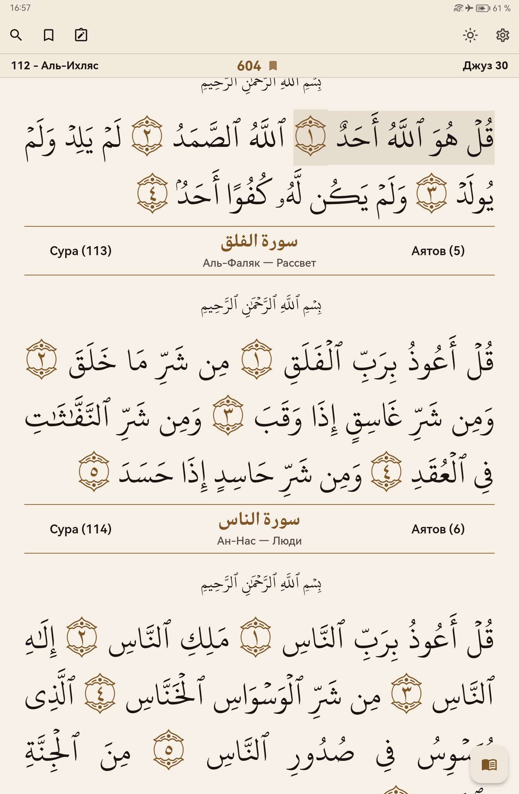
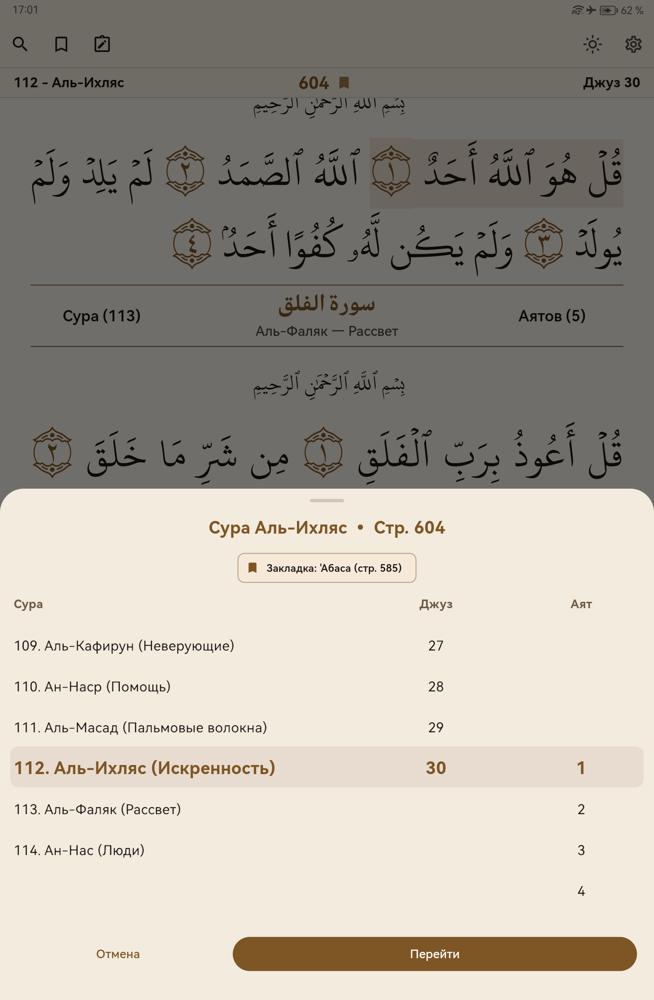
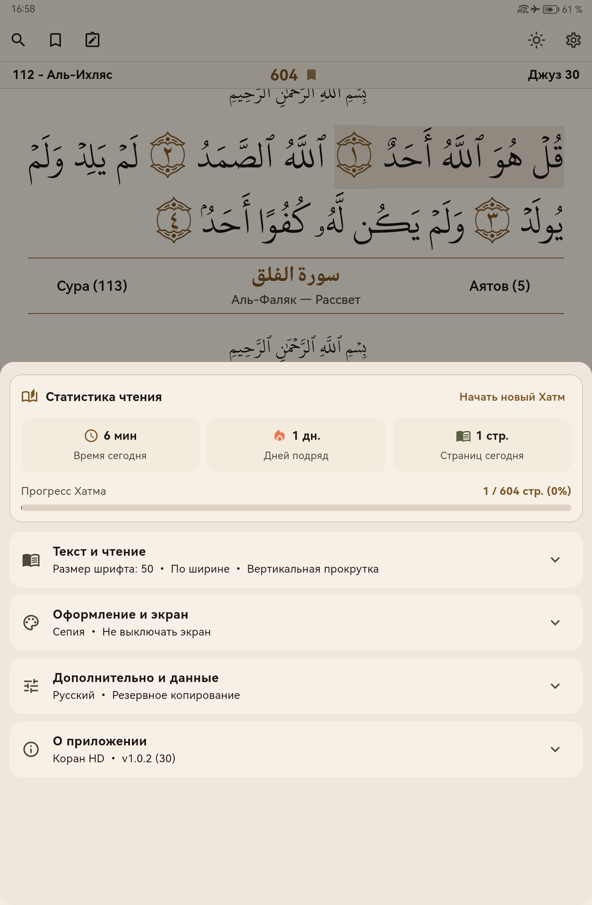
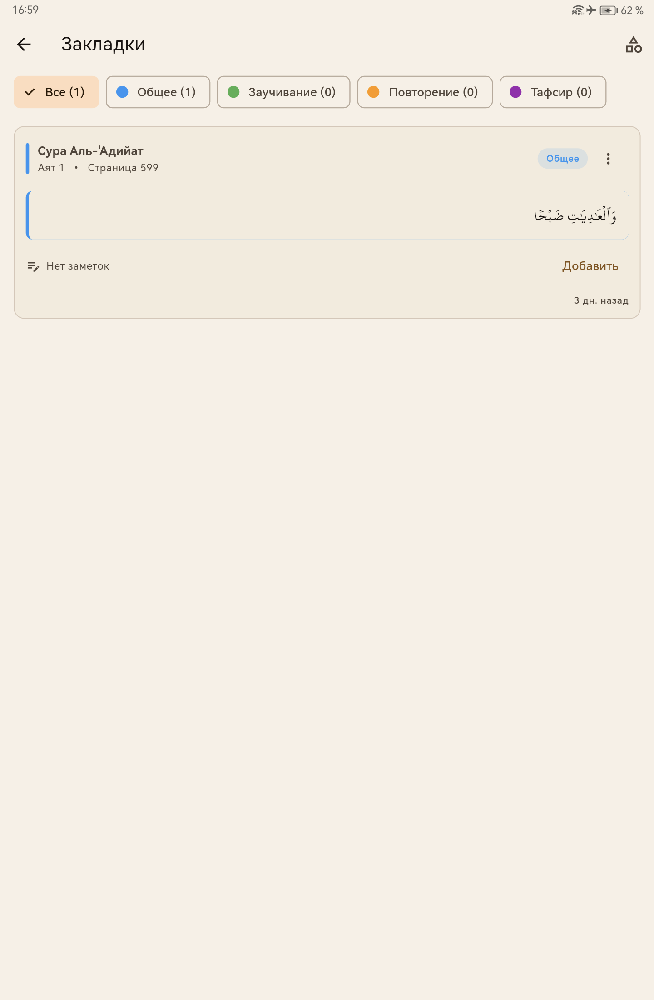

<div align="center">

  
  <br>

  # Коран HD (Tablet Edition)

  **Современное, быстрое и полностью автономное приложение для чтения Священного Корана, оптимизированное для планшетов и устройств с большими экранами.**

  [](LICENSE)
  [](https://developer.android.com)
  [](https://appgallery.cloud.huawei.com/ag/n/app/C119285551)
  [-emerald.svg)](https://github.com/solemetra/my_quran_book/releases)

</div>

---

## 📖 О приложении

**Коран HD (Tablet Edition)** разработано с акцентом на комфортное ежедневное чтение на больших дисплеях планшетов. Приложение передает эстетику классического печатного мединского мусхафа с кристальной четкостью шрифтов и поддержкой горизонтального и вертикального режимов.

### ✨ Основные возможности

* 📴 **100% Офлайн и приватность:** не требует подключения к интернету, работает без рекламы, без сбора аналитики и трекеров.
* 🖥️ **Адаптация под планшеты:** великолепно масштабируется под экраны планшетов (альбомный разворот и портретный книжный режим).
* 🔖 **Продвинутая система закладок:**
  * **Центральная закладка Хатма:** закрепление страницы текущего чтения с быстрым переходом из навигации.
  * **Категории закладок:** организация по темам (*Общее*, *Заучивание*, *Повторение*, *Тафсир*) с цветными метками и сохранением между сессиями.
* 📊 **Хатм и статистика чтения:** отслеживание времени чтения сегодня, серий непрерывных дней (streak) и общего прогресса Хатма (из 604 страниц).
* 🧭 **Удобная навигация на русском языке:** мгновенный переход: Сура → Джуз → Аят или номер страницы, с отображением русских названий сур и перевода их значений.
* 🎨 **Темы и персонализация (Material 3):**
  * Режим «Сепия» с теплым бумажным оттенком для комфорта глаз.
  * Тёмная тема (AMOLED) для чтения при слабом освещении.
  * Режим предотвращения засыпания экрана во время чтения.
  * Высокая производительность и плавная анимация (до 120 FPS).

---

## 📸 Скриншоты (Версия для планшетов)

### Альбомный режим (Планшет)
<div align="center">
  
</div>

<br>

### Портретный режим и интерфейс
<div align="center">

| Режим чтения | Навигация по сурам | Настройки и Хатм | Закладки |
|:---:|:---:|:---:|:---:|
|  |  |  |  |

</div>

---

## 📥 Установка

* **Huawei AppGallery:** [Коран HD в AppGallery](https://appgallery.cloud.huawei.com/ag/n/app/C119285551)
* **Прямая установка APK:** скачайте актуальный универсальный APK-файл из раздела [Releases](https://github.com/solemetra/my_quran_book/releases).

---

## 🛠️ Сборка из исходников

Для сборки проекта требуется установленный [Flutter SDK](https://flutter.dev) (3.x+):

```bash
# Клонирование репозитория
git clone https://github.com/solemetra/my_quran_book.git
cd my_quran_book

# Загрузка зависимостей
flutter pub get

# Запуск в режиме разработки
flutter run

# Сборка релизного APK
flutter build apk --release

# Сборка релизного AppBundle (AAB) для магазинов
flutter build appbundle --release
```

---

## 📜 Лицензия и авторские права

* **Кодовая база:** распространяется под свободной лицензией [GNU General Public License v3](LICENSE).
* **Шрифты и коранический текст:** шрифты KFGQPC (Комплекс имени Короля Фахда по изданию Священного Корана), подробнее см. [NOTICE.md](NOTICE.md).
* **Авторское право:** см. [COPYRIGHT.md](COPYRIGHT.md).
